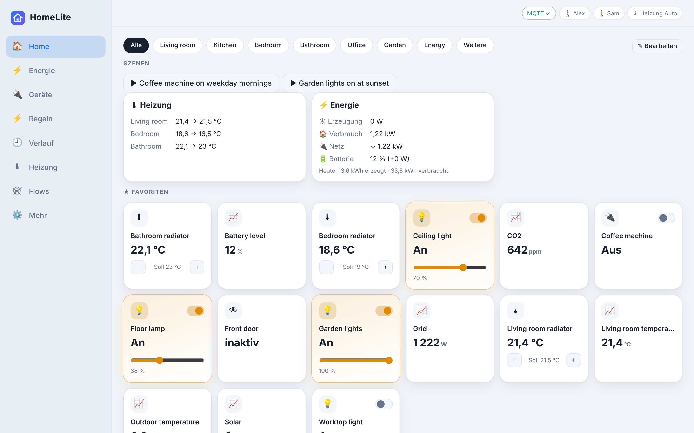
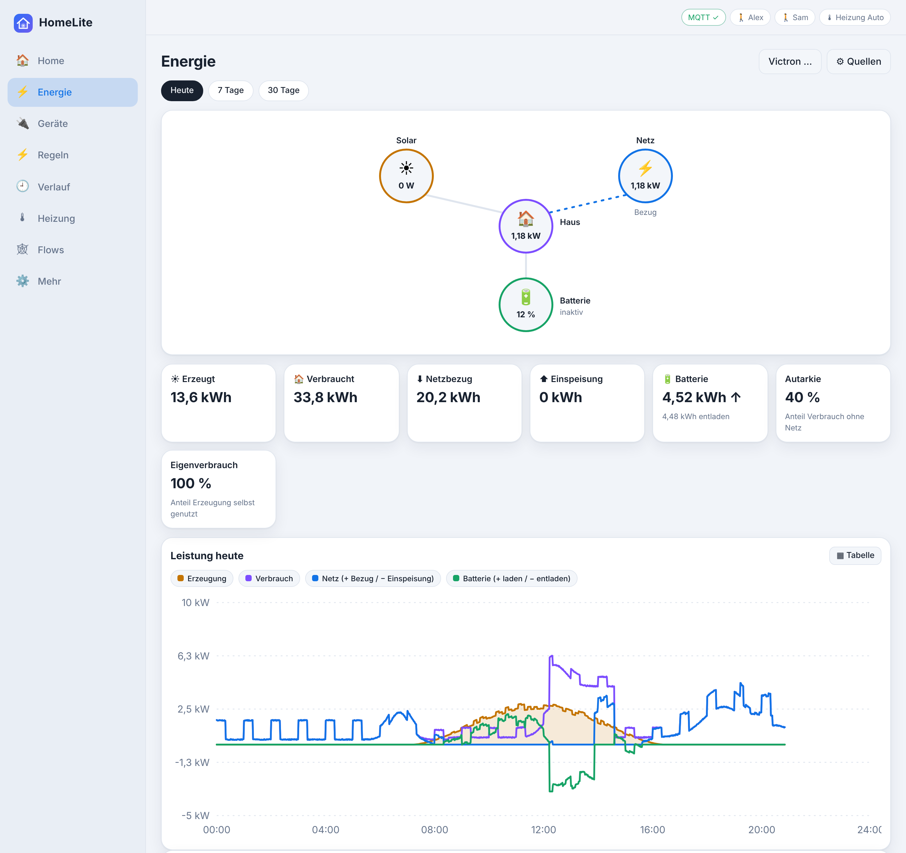
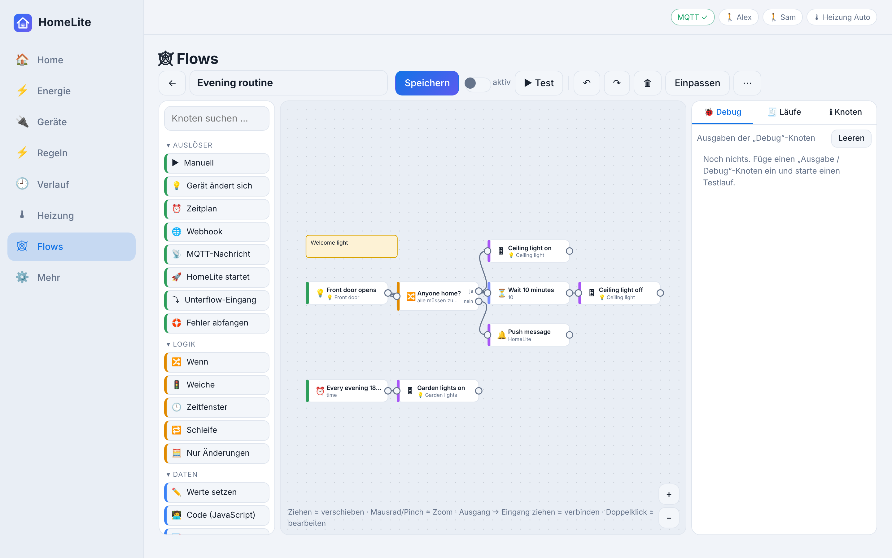

<p align="center">
  
</p>

<p align="center">
  <a href="LICENSE"></a>
  
  <a href="https://paypal.me/RolandFriedl"></a>
</p>

# HomeLite

**Lightweight, self-hosted home automation in Node.js.** Runs on a home server or a Raspberry Pi (Pi 2 and newer). No cloud account required, no build step, all data in a single SQLite file.

| Dashboard | Energy | Flow editor |
|---|---|---|
|  |  |  |

<sub>Screenshots show invented demo data.</sub>

## Why HomeLite

- **Small footprint** – one Node.js process, one SQLite file, starts in seconds, runs on a Raspberry Pi 2
- **Local first** – works entirely inside your home network; cloud services are optional and only used by plugins you enable
- **Nothing to compile** – `npm install`, `node server.js`, done
- **Extensible** – plugins add devices, pages and automation actions without a system update
- **AI-ready** – built-in MCP server so an AI assistant can read and control devices and draft automations

## Features

- **Devices:** MQTT (built-in broker included), Shelly (Gen1 CoIoT, Gen2+), HTTP sensors, Matter, media player status, weather stations, dew point calculation, virtual devices
- **Automations:** triggers, conditions (AND/OR, "triggered by"), modes, sunrise/sunset, webhooks
- **Flows (plugin):** visual node-based editor for complex sequences – see [docs/FLOWS.md](docs/FLOWS.md)
- **Energy:** PV, battery and grid, daily and monthly totals, quarter-hour grid peaks with a 5-day review
- **Heating, phone geofencing, "Where is?" map**
- **AI access (MCP):** an MCP-capable assistant can read and control devices and draft automations. Automations and flows created this way always start **disabled**.
- **Plugins:** extensions without a system update – [docs/PLUGINS.md](docs/PLUGINS.md)
- **Comfort:** editable dashboard, history, backup and restore, one-click update

## Quick start

Requires Node.js 22 or newer.

```bash
git clone https://github.com/friedlro/Homelite.git
cd Homelite
npm install --omit=dev
node server.js          # http://<server>:3100
```

The initial login password is printed to the console (or log) on first start:
`journalctl -u homelite | grep -i passwort`

Running as a service (systemd), Raspberry Pi images and updates: [docs/INSTALLATION.md](docs/INSTALLATION.md).

## Plugins (`plugins-example/`)

Plugins are optional. Nothing in this list is active until you install and enable it.

| Plugin | Purpose |
|---|---|
| `flows` | Visual flow editor: webhooks, MQTT, sub-flows, execution history, custom nodes |
| `zigbee2mqtt` | Zigbee devices via a Zigbee2MQTT instance: auto-discovery, pairing, renaming, setup assistant |
| `zwave` | Z-Wave via zwave-js-server: switches, dimmers, locks, thermostats, sensors, buttons |
| `tuya` | Tuya / Smart Life devices, local (LAN) with cloud fallback |
| `philips-hue` | Hue bridge |
| `tapo-kamera` | Tapo cameras, local only (ONVIF/RTSP): motion and person detection as devices, snapshot, live view, pan/tilt presets |
| `alarmzentrale` | Alarm logic: freely selectable sensors and sirens, home/away, delays, PIN, log |
| `esp32-display` | ESP32 with an SPI touch display as a wall panel; firmware included: [firmware/esp32-display](firmware/esp32-display/README.md) |
| `bmw` | BMW/MINI vehicle data via the manufacturer's official customer data interface (read-only) |
| `leapmotor` | Leapmotor vehicle data and remote commands. **Unofficial, experimental** – see notice below |
| `tomons-wallbox` | Tomons mobile wallbox: power, energy, cable state, charge current limit. **Unofficial, experimental** – see notice below |
| `siocs-heizung` | District heating controller via its web portal: sensors, operating mode, schedules |
| `claude` | Chat assistant inside HomeLite, using a locally installed Claude Code CLI and your own account |
| `ssh` | SSH access for the AI integration |
| `systemmonitor` | CPU, RAM, temperature and disk usage of the server, with warnings |
| `tailscale` | Tailscale status, devices in the tailnet, warning when something is exposed to the internet |
| `muellkalender` | Waste collection calendar |
| `erreichbarkeit` | Reachability checks for devices and addresses |
| `duckdns` | DuckDNS client |

Install: *Settings → Extensions → Plugins* (file or URL), or copy the folder to `data/plugins/<id>`. The "Available plugins" section lists everything in this repository for one-click installation and shows updates when a newer version exists.

### Notice on unofficial integrations

Plugins marked **unofficial** talk to services for which the manufacturer provides no public, documented interface. They are provided for private interoperability with devices and accounts **you own**, and:

- they are not endorsed, supported or approved by the respective manufacturer,
- they may stop working at any time,
- using them may be restricted by the terms of service of the respective provider – checking this, and the decision to use them, is your responsibility,
- they ship without any credentials, certificates or keys; you supply your own.

## Firmware (`firmware/`)

Firmware for your own devices that work with HomeLite. Separate from plugins and not installed with them.

| Folder | Purpose |
|---|---|
| [`firmware/esp32-display`](firmware/esp32-display/README.md) | ESP32 with common SPI displays (PlatformIO, one environment per controller: ILI9341, ILI9486, ILI9488, ST7796, ST7789) for the `esp32-display` plugin: pages and tiles from HomeLite, touch to switch, screensaver with clock |

## Documentation

The documentation is currently written in German.

| File | Content |
|---|---|
| [docs/INSTALLATION.md](docs/INSTALLATION.md) | Installation, systemd, Raspberry Pi, update, backup |
| [docs/SICHERHEIT.md](docs/SICHERHEIT.md) | Security measures, recommendations, running without root |
| [docs/HANDBUCH.md](docs/HANDBUCH.md) | Full manual for all features |
| [docs/FLOWS.md](docs/FLOWS.md) | Flow plugin: nodes, expressions, error handling, extending |
| [docs/PLUGINS.md](docs/PLUGINS.md) | Plugin API (server, UI, MQTT, webhook, MCP) |
| [docs/ARCHITEKTUR.md](docs/ARCHITEKTUR.md) | Code structure and data flows |
| [docs/CHANGELOG.md](docs/CHANGELOG.md) | Changes per version |

## Security

Password login with a signed cookie; MCP and webhooks require a secret token. HomeLite belongs inside your home network. For remote access use a VPN or a reverse proxy with HTTPS. Only the key-protected paths `/mcp`, `/hook`, `/trigger` and `/where.html` answer requests from outside, with rate limiting and scanner blocking – details in [docs/SICHERHEIT.md](docs/SICHERHEIT.md).

Plugins and flows run with the permissions of the HomeLite service. Install only plugins you trust.

Personal data (`data/`) is excluded from the repository via `.gitignore`.

## Disclaimer

HomeLite is a private open-source project, provided **"as is", without warranty of any kind**, as stated in the [MIT License](LICENSE).

- **Not a safety or security product.** HomeLite, including the alarm, lock, heating, vehicle and charging functions, is not certified and must not be relied on to protect people or property. Do not use it as the only safeguard for anything where a failure could cause damage or injury.
- **Mains voltage and vehicles.** Have electrical installations done by a qualified electrician. You are responsible for every command sent to your devices, heating system, vehicle or charger.
- **Privacy.** If you use cameras, location tracking or presence detection, you are responsible for complying with the data protection laws that apply to you, including informing other people in your household and visitors.
- **Third-party services.** You are responsible for complying with the terms of the services and accounts you connect.

## Trademarks

All product names, brands and trademarks mentioned in this repository belong to their respective owners. They are used only to describe compatibility. HomeLite is an independent project and is **not affiliated with, endorsed by or sponsored by** any of these companies or projects.

## Third-party code

Some plugins bundle third-party open-source components under their own licenses. The license texts and notices are kept in the respective plugin folders (`NOTICE.md`, `LICENSE-*`).

## License

[MIT](LICENSE) © Roland Friedl

## Support the project

HomeLite is free and has no ads. If you find it useful, a voluntary donation is welcome: [paypal.me/RolandFriedl](https://paypal.me/RolandFriedl). Donations are voluntary and do not entitle you to support or any other service.

Bug reports and ideas: [GitHub Issues](https://github.com/friedlro/Homelite/issues).
